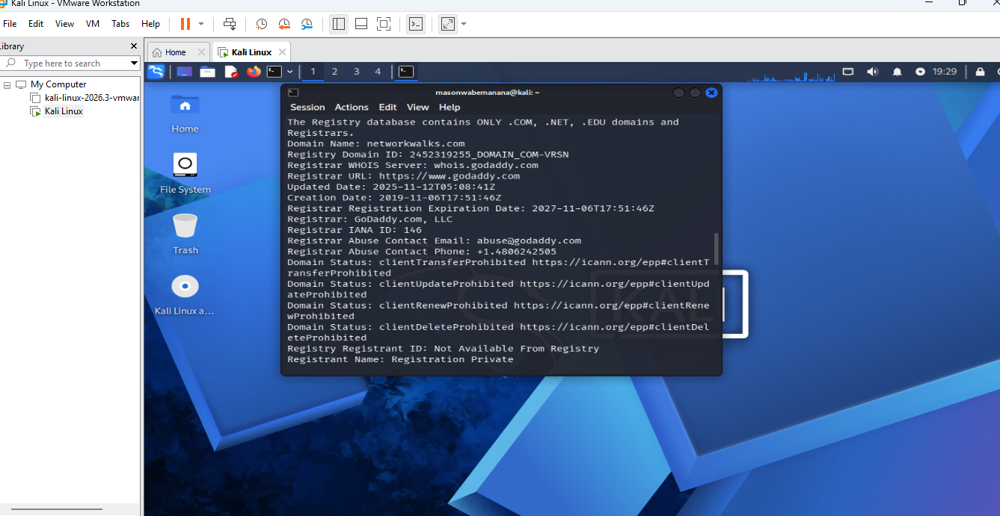

# Networkwalks-B084-Week2-Penetration-Testing-Report
# PENETRATION TESTING REPORT 
### Footprinting & Network Scanning Phases

**W2-PM-FINAL  |  CYBERSECURITY  |  NETWORKWALKS**

| Field | Detail |
|---|---|
| **Pentester Name (Cybersecurity Professional)** | **Masonwabe Manana** |
| **Program/Batch** | B084-Networkwalks |
| **Date** | 14 November 2026 |
| **Modules completed** | W2-PM1 (Multiple Kali Tools) W2-PM5 (Zenmap Scanning)  Pentesting Report|
| **Client/Target** | 1. Networkwalks (written permission granted) 2. My own local LAN Network |
| **Permission secured from client?** | Yes |
| **Phases covered** | **Phase 1:**  Footprinting & Reconnaissance **Phase 2:** Network scanning with Zenmap

# 1. Liability Disclaimer

This project involves footprinting, reconnaissance, and network scanning using Zenmap. Prior authorization was obtained for all devices scanned, and all materials are utilised strictly for educational and research purposes.

# 2. Introduction

This report covers footprinting the networkwalks.com domain using multiple Kali Linux tools (W2-PM1) and scanning my own local network with Zenmap (W2-PM5). One module covers the footprinting phase and the other covers the scanning phase, so together they show how an attacker moves from gathering public information to mapping live hosts on a network. It is the Week 2 part of my ongoing internship program at Networkwalks.

All commands were run in Kali Linux (footprinting) and on a Windows PC with Zenmap installed (scanning). Every step below includes the exact command used, the result I observed, a screenshot as evidence, and a short note on why the finding matters from an attacker's point of view.

# 8. Evidences Collected

*Screenshots for the activities*

Domain registration details of the target

Fingerprinting the website

