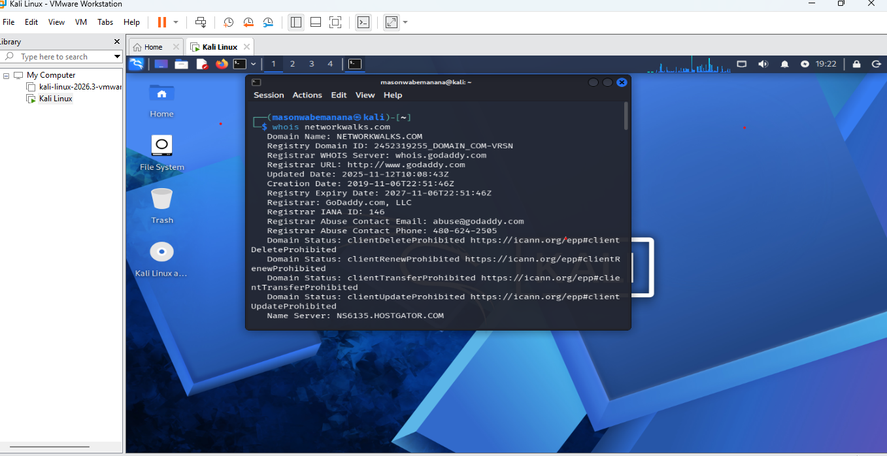
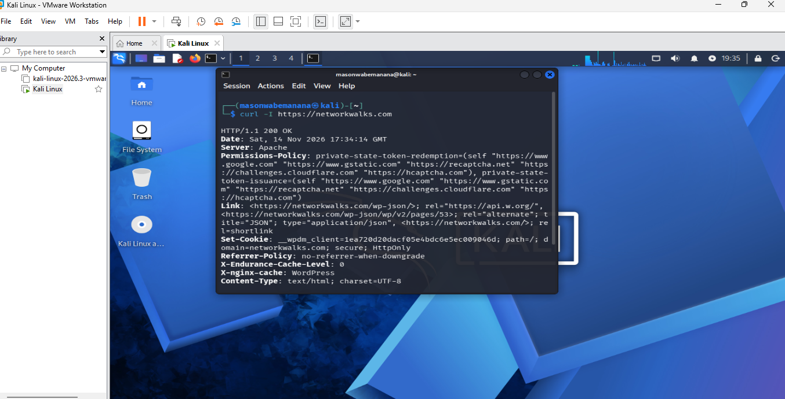
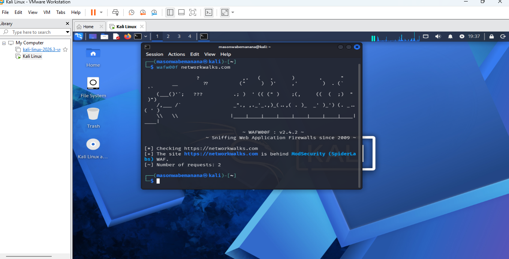
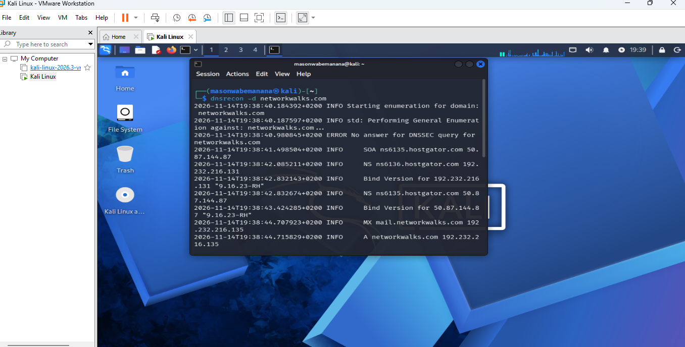
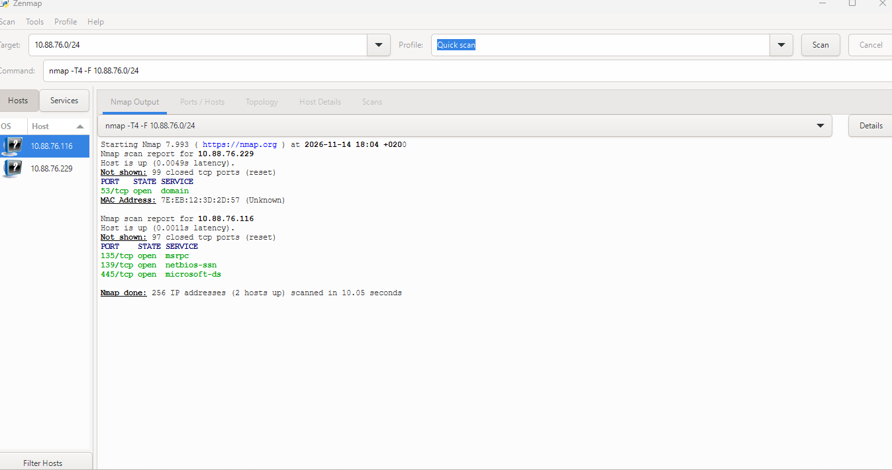
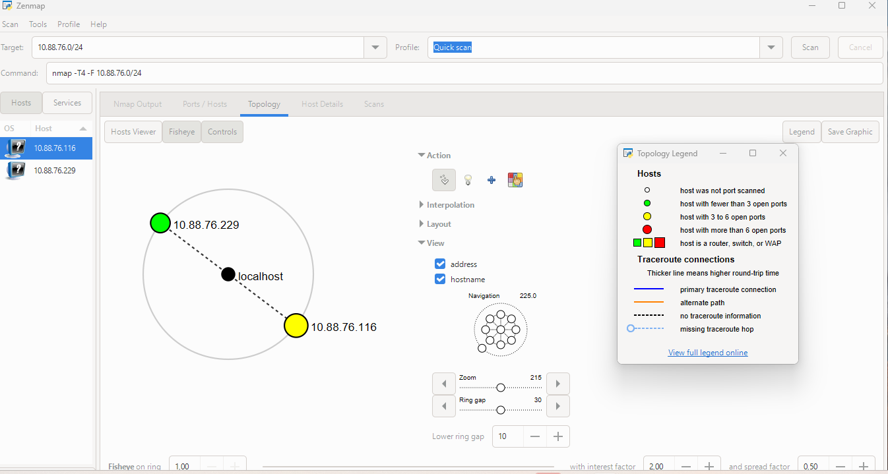

# Networkwalks-B084-Week2-Penetration-Testing-Report
# PENETRATION TESTING REPORT 
### Footprinting & Network Scanning Phases

**W2-PM-FINAL  |  CYBERSECURITY  |  NETWORKWALKS**

| Field | Detail |
|---|---|
| **Pentester Name (Cybersecurity Professional)** | **Masonwabe Manana** |
| **Program/Batch** | B084-Networkwalks |
| **Date** | 14 November 2026 |
| **Modules completed** | W2-PM1 (Multiple Kali Tools) W2-PM5 (Zenmap Scanning)  Pentesting Report|
| **Client/Target** | 1. Networkwalks (written permission granted) 2. My own local LAN Network |
| **Permission secured from client?** | Yes |
| **Phases covered** | **Phase 1:**  Footprinting & Reconnaissance **Phase 2:** Network scanning with Zenmap

# 1. Liability Disclaimer

This project involves footprinting, reconnaissance, and network scanning using Zenmap. Prior authorization was obtained for all devices scanned, and all materials are utilised strictly for educational and research purposes.

# 2. Introduction

This report covers footprinting and reconnaissance on the 'networkwalks.com' domain using multiple Kali Linux tools. It also includes scanning of local IP addresses using Zenmap. Footprinting and reconnaisance allows vulnerabilities in systems to be detected quickly.
Commands for footprinting were ran on kali linux, while scanning was through Zenmap installed on windows.

# 3. Tools Used

| Kali Linux & Windows            
| WHOIS                
| whatweb            
| nslookup             
| curl -I              
| wafw00f              
| dnsrecon             
| Zenmap (Nmap GUI)    
| Windows CMD          

# 4. Activities Performed

 Footprinting & Reconnaissance

'Networkwalks.com' was used as the target network for this project, therefore will be referred to as the 'target' through its entirety. The first step was to gather information about the target. I used six kali linux tools for this; they include whois, whatweb, nslookup, curl, waf00f and dnsrecon. Whois was used to find out who owns the website, by showing the domain registration information. Whatweb identified the technologies used to build the website. Nslookup was used to collect basic domain name system (DNS) of the target network. 
Curl was used to detect the responding HTTP headers. Waf00f was used to list and identify firewalls protecting the target. Dnsrecon was used to dig all DNS of the target.

# 5. Network Scanning with Zenmap

Zenmap was used to scan local network. Here, I identified my local IP address and subnet, local live hosts, with their IP and MAC addresses generated on a network topology.

I first used the Windows `ipconfig` command to identify my local IP address and LAN subnet. I then entered the subnet into Zenmap and selected **Ping Scan** to identify active hosts.

I identified two live hosts:

- `10.88.76.229`
- `10.88.76.116`

  I noticed that '10.88.76.229' was the most critical host, and '10.88.76.11' being the most exposed.

# 6. Evidences Collected

*Screenshots for the activities*

Domain registration details of the target

Fingerprinting the target website

DNS information of the target

HTTP response headers of the target

Detecting Web application firewall of the target

Finding hidden subdomains and servers of the target

*Scanning local IP addresses using Zenmap*

IP address Topology for live hosts

# 7. RISK ANALYSIS

According to  ISO 31000 Enterprise Risk Management Framework should manage their risk through an integrated, and structured framework that continuously identifies, analyses, evaluates and monitors threats. These risks are classified by accessing their likelihood and impact, producing either a low, medium, high or extreme risk, then by source( whether strategic, operational, financial, compliance) , and finally by whether or not they are acceptable, tolerable, or unacceptable.

Risks are also classified by what you will do with them;

a) Acceptable risk : It is a low risk, one can with live it. 

b) Tolerable risk : Medium risk- you threat it and continue operation.

c) Unacceptable risk : High or extreme risk- you must threat it now.

ON NETWORKWALKS.COM

Acceptable risks(low) - 2 risks were found. The domain hijacking and expiry. They can be accepted and monitored.

Tolerable risks ( medium- high) - 8 risks were identified. WHOIS exposure, email harvesting, missing headers, mail server, WAF bypass, DNS port 53, NetBIOS port 139. These must be attended to, but the operations can continue.

Unacceptable risks(high) - 4 risks were identified - the exposed wordpress versions, missing DNSSEC, MSRPC port 135, and SMB port 445. These should be threated urgently.

ON LOCAL IP ADDRESSES FOUND

Windows host at 10.88.76.116 shows high-risk ports 135, 139, and 445 , creating a high-risk of SMB exploitation and lateral movements, while 10.88.76.229 exposes only DNS port 53, presenting a medium risk of DNS sooting.

# 8. CONCLUSION

In this project I got exposure to different kali linux tools and their use. I also learned how crucial it is for network systems to be secure, and how easy a system can crash through open ports, if not properly patched.

